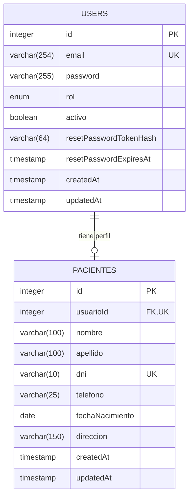

# Modelo de datos: usuarios y pacientes

Este documento describe las tablas involucradas en los módulos de usuarios y
pacientes: `users` y `pacientes`.

## Diagrama ER



## Tabla `users`

Cuentas de acceso al sistema. Implementada en `src/models/Usuario.ts`.

| Campo                    | Tipo           | Nulo | Default         | Restricciones                                     |
| ------------------------ | -------------- | ---- | --------------- | ------------------------------------------------- |
| `id`                     | `INTEGER`      | No   | Autoincremental | PK                                                |
| `email`                  | `VARCHAR(254)` | No   | —               | Único; formato de email; entre 3 y 254 caracteres |
| `password`               | `VARCHAR(255)` | No   | —               | Hash bcrypt                                       |
| `rol`                    | `ENUM`         | No   | —               | `PACIENTE`, `PROFESIONAL` o `ADMIN`               |
| `activo`                 | `BOOLEAN`      | No   | `true`          | Indica si la cuenta puede iniciar sesión          |
| `resetPasswordTokenHash` | `VARCHAR(64)`  | Sí   | `NULL`          | SHA-256 del token de recuperación                 |
| `resetPasswordExpiresAt` | `TIMESTAMP`    | Sí   | `NULL`          | Fecha de expiración del token                     |
| `createdAt`              | `TIMESTAMP`    | No   | Automático      | —                                                 |
| `updatedAt`              | `TIMESTAMP`    | No   | Automático      | —                                                 |

### Notas

- El email se guarda normalizado: sin espacios en los extremos y en minúsculas.
- La contraseña nunca se guarda en texto plano; se hashea con bcrypt usando
  `BCRYPT_SALT_ROUNDS` (por defecto `10`).
- Los campos `password`, `resetPasswordTokenHash` y `resetPasswordExpiresAt`
  se excluyen de todas las respuestas de la API.
- Una cuenta `PACIENTE` siempre tiene un registro asociado en `pacientes`.
- Una cuenta puede estar desactivada (`activo: false`) sin eliminarse.

## Tabla `pacientes`

Datos personales del paciente. Implementada en `src/models/Paciente.ts`.

| Campo             | Tipo           | Nulo | Default         | Restricciones                          |
| ----------------- | -------------- | ---- | --------------- | -------------------------------------- |
| `id`              | `INTEGER`      | No   | Autoincremental | PK                                     |
| `usuarioId`       | `INTEGER`      | No   | —               | Único; FK a `users.id`                 |
| `nombre`          | `VARCHAR(100)` | No   | —               | Entre 2 y 100 caracteres               |
| `apellido`        | `VARCHAR(100)` | No   | —               | Entre 2 y 100 caracteres               |
| `dni`             | `VARCHAR(10)`  | No   | —               | Único; entre 7 y 8 dígitos             |
| `telefono`        | `VARCHAR(25)`  | No   | —               | Entre 6 y 25 dígitos, con `+` opcional |
| `fechaNacimiento` | `DATEONLY`     | No   | —               | Formato `YYYY-MM-DD`; no futura        |
| `direccion`       | `VARCHAR(150)` | No   | —               | Entre 3 y 150 caracteres               |
| `createdAt`       | `TIMESTAMP`    | No   | Automático      | —                                      |
| `updatedAt`       | `TIMESTAMP`    | No   | Automático      | —                                      |

### Clave foránea

```text
pacientes.usuarioId → users.id
ON UPDATE CASCADE
ON DELETE RESTRICT
```

## Relaciones

- `Usuario` **1 a 1** `Paciente`: un usuario con rol `PACIENTE` tiene un único
  perfil, y un paciente pertenece a un único usuario.
- La relación se define en `src/models/index.ts` con los alias `usuario` y
  `paciente`.
- `Paciente` también se relaciona **1 a N** con `Turno` y `Estudio`. Esas
  relaciones son las que impiden eliminar un paciente con actividad asociada
  (`DELETE /api/pacientes/:id` responde `409`).
- `Usuario` también puede tener un perfil `Profesional` (relación 1 a 1). Un
  usuario no puede tener simultáneamente perfil de paciente y de profesional
  por la semántica de los endpoints de alta, aunque cada tabla tenga su propia
  FK única.

## Borrado de un paciente

`DELETE /api/pacientes/:id` realiza, en una transacción:

1. Verifica que no existan turnos ni estudios del paciente.
2. Elimina el registro de `pacientes`.
3. Elimina la cuenta correspondiente en `users`.

La FK `ON DELETE RESTRICT` de `pacientes.usuarioId` protege la cuenta: si se
intentara borrar el usuario primero, la base rechazaría la operación. Por eso
el orden de borrado es paciente y luego usuario.

## Migraciones y seeders

| Archivo                                                                 | Contenido                                       |
| ----------------------------------------------------------------------- | ----------------------------------------------- |
| `src/database/migrations/20261008231144-create-users.js`                | Crea `users`                                    |
| `src/database/migrations/20261008231150-create-pacientes.js`            | Crea `pacientes`                                |
| `src/database/migrations/20261104000000-add-reset-password-to-users.js` | Agrega campos de recuperación a `users`         |
| `src/database/seeders/20261010000001-seed-users.js`                     | Usuarios de prueba (incluye el `ADMIN` inicial) |
| `src/database/seeders/20261010000002-seed-pacientes.js`                 | Pacientes de prueba                             |

Credenciales de los seeders: contraseña `Password123` para todas las cuentas.
El administrador inicial es `admin@tfi.local.com`.
