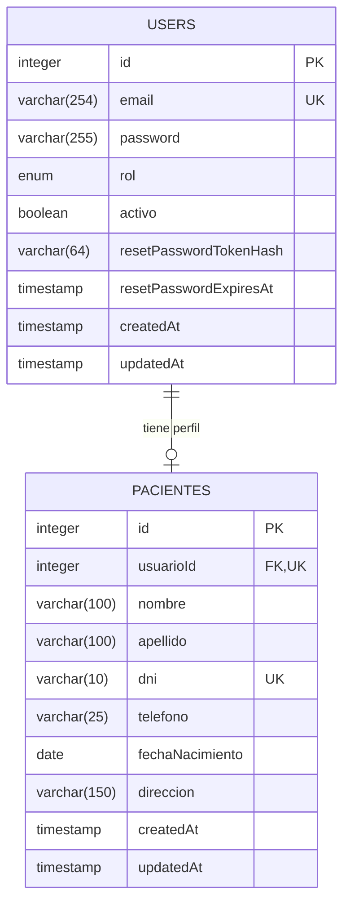
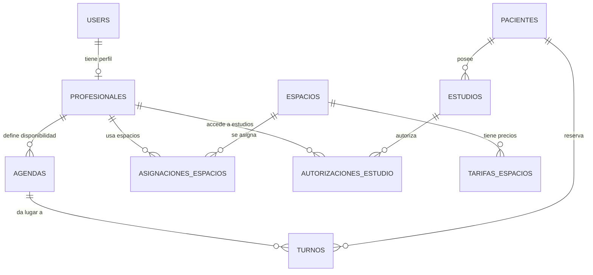

# Modelo de datos

Este documento describe las tablas del sistema: `users`, `pacientes`,
`profesionales`, `espacios`, `asignaciones_espacios`, `tarifas_espacios`,
`agendas`, `turnos`, `estudios` y `autorizaciones_estudio`.

## Diagrama ER



## Tabla `users`

Cuentas de acceso al sistema. Implementada en `src/models/Usuario.ts`.

| Campo                    | Tipo           | Nulo | Default         | Restricciones                                     |
| ------------------------ | -------------- | ---- | --------------- | ------------------------------------------------- |
| `id`                     | `INTEGER`      | No   | Autoincremental | PK                                                |
| `email`                  | `VARCHAR(254)` | No   | —               | Único; formato de email; entre 3 y 254 caracteres |
| `password`               | `VARCHAR(255)` | No   | —               | Hash bcrypt                                       |
| `rol`                    | `ENUM`         | No   | —               | `PACIENTE`, `PROFESIONAL` o `ADMIN`               |
| `activo`                 | `BOOLEAN`      | No   | `true`          | Indica si la cuenta puede iniciar sesión          |
| `resetPasswordTokenHash` | `VARCHAR(64)`  | Sí   | `NULL`          | SHA-256 del token de recuperación                 |
| `resetPasswordExpiresAt` | `TIMESTAMP`    | Sí   | `NULL`          | Fecha de expiración del token                     |
| `createdAt`              | `TIMESTAMP`    | No   | Automático      | —                                                 |
| `updatedAt`              | `TIMESTAMP`    | No   | Automático      | —                                                 |

### Notas

- El email se guarda normalizado: sin espacios en los extremos y en minúsculas.
- La contraseña nunca se guarda en texto plano; se hashea con bcrypt usando
  `BCRYPT_SALT_ROUNDS` (por defecto `10`).
- Los campos `password`, `resetPasswordTokenHash` y `resetPasswordExpiresAt`
  se excluyen de todas las respuestas de la API.
- Una cuenta `PACIENTE` siempre tiene un registro asociado en `pacientes`.
- Una cuenta puede estar desactivada (`activo: false`) sin eliminarse.

## Tabla `pacientes`

Datos personales del paciente. Implementada en `src/models/Paciente.ts`.

| Campo             | Tipo           | Nulo | Default         | Restricciones                          |
| ----------------- | -------------- | ---- | --------------- | -------------------------------------- |
| `id`              | `INTEGER`      | No   | Autoincremental | PK                                     |
| `usuarioId`       | `INTEGER`      | No   | —               | Único; FK a `users.id`                 |
| `nombre`          | `VARCHAR(100)` | No   | —               | Entre 2 y 100 caracteres               |
| `apellido`        | `VARCHAR(100)` | No   | —               | Entre 2 y 100 caracteres               |
| `dni`             | `VARCHAR(10)`  | No   | —               | Único; entre 7 y 8 dígitos             |
| `telefono`        | `VARCHAR(25)`  | No   | —               | Entre 6 y 25 dígitos, con `+` opcional |
| `fechaNacimiento` | `DATEONLY`     | No   | —               | Formato `YYYY-MM-DD`; no futura        |
| `direccion`       | `VARCHAR(150)` | No   | —               | Entre 3 y 150 caracteres               |
| `createdAt`       | `TIMESTAMP`    | No   | Automático      | —                                      |
| `updatedAt`       | `TIMESTAMP`    | No   | Automático      | —                                      |

### Clave foránea

```text
pacientes.usuarioId → users.id
ON UPDATE CASCADE
ON DELETE RESTRICT
```

## Relaciones

- `Usuario` **1 a 1** `Paciente`: un usuario con rol `PACIENTE` tiene un único
  perfil, y un paciente pertenece a un único usuario.
- La relación se define en `src/models/index.ts` con los alias `usuario` y
  `paciente`.
- `Paciente` también se relaciona **1 a N** con `Turno` y `Estudio`. Esas
  relaciones son las que impiden eliminar un paciente con actividad asociada
  (`DELETE /api/pacientes/:id` responde `409`).
- `Usuario` también puede tener un perfil `Profesional` (relación 1 a 1). Un
  usuario no puede tener simultáneamente perfil de paciente y de profesional
  por la semántica de los endpoints de alta, aunque cada tabla tenga su propia
  FK única.

## Borrado de un paciente

`DELETE /api/pacientes/:id` realiza, en una transacción:

1. Verifica que no existan turnos ni estudios del paciente.
2. Elimina el registro de `pacientes`.
3. Elimina la cuenta correspondiente en `users`.

La FK `ON DELETE RESTRICT` de `pacientes.usuarioId` protege la cuenta: si se
intentara borrar el usuario primero, la base rechazaría la operación. Por eso
el orden de borrado es paciente y luego usuario.

## Resto de tablas



### Tabla `profesionales`

Implementada en `src/models/Profesional.ts`.

| Campo          | Tipo           | Nulo | Default         | Restricciones                          |
| -------------- | -------------- | ---- | --------------- | -------------------------------------- |
| `id`           | `INTEGER`      | No   | Autoincremental | PK                                     |
| `usuarioId`    | `INTEGER`      | No   | —               | Único; FK a `users.id`                 |
| `nombre`       | `VARCHAR(100)` | No   | —               | Entre 2 y 100 caracteres               |
| `apellido`     | `VARCHAR(100)` | No   | —               | Entre 2 y 100 caracteres               |
| `dni`          | `VARCHAR(10)`  | No   | —               | Único; entre 7 y 8 dígitos             |
| `telefono`     | `VARCHAR(25)`  | No   | —               | Entre 6 y 25 dígitos, con `+` opcional |
| `matricula`    | `VARCHAR(30)`  | No   | —               | Única; entre 1 y 30 caracteres         |
| `especialidad` | `VARCHAR(100)` | No   | —               | Entre 2 y 100 caracteres               |
| `createdAt`    | `TIMESTAMP`    | No   | Automático      | —                                      |
| `updatedAt`    | `TIMESTAMP`    | No   | Automático      | —                                      |

### Tabla `espacios`

Implementada en `src/models/Espacio.ts`.

| Campo       | Tipo           | Nulo | Default         | Restricciones              |
| ----------- | -------------- | ---- | --------------- | -------------------------- |
| `id`        | `INTEGER`      | No   | Autoincremental | PK                         |
| `nombre`    | `VARCHAR(100)` | No   | —               | Entre 1 y 100 caracteres   |
| `tipo`      | `ENUM`         | No   | —               | `GIMNASIO` o `CONSULTORIO` |
| `ubicacion` | `ENUM`         | No   | —               | `ADELANTE` o `ATRAS`       |
| `activo`    | `BOOLEAN`      | No   | `true`          | —                          |
| `createdAt` | `TIMESTAMP`    | No   | Automático      | —                          |
| `updatedAt` | `TIMESTAMP`    | No   | Automático      | —                          |

### Tabla `asignaciones_espacios`

Implementada en `src/models/AsignacionEspacio.ts`.

| Campo           | Tipo        | Nulo | Default         | Restricciones                              |
| --------------- | ----------- | ---- | --------------- | ------------------------------------------ |
| `id`            | `INTEGER`   | No   | Autoincremental | PK                                         |
| `espacioId`     | `INTEGER`   | No   | —               | FK a `espacios.id`                         |
| `profesionalId` | `INTEGER`   | No   | —               | FK a `profesionales.id`                    |
| `tipo`          | `ENUM`      | No   | —               | `FIJA` o `ESPECIFICA`                      |
| `diaSemana`     | `ENUM`      | Sí   | `NULL`          | Obligatorio si `FIJA`; `LUNES` a `DOMINGO` |
| `fecha`         | `DATEONLY`  | Sí   | `NULL`          | Obligatorio si `ESPECIFICA`; `YYYY-MM-DD`  |
| `horaInicio`    | `TIME`      | No   | —               | `HH:mm`; menor que `horaFin`               |
| `horaFin`       | `TIME`      | No   | —               | `HH:mm`                                    |
| `createdAt`     | `TIMESTAMP` | No   | Automático      | —                                          |
| `updatedAt`     | `TIMESTAMP` | No   | Automático      | —                                          |

### Tabla `tarifas_espacios`

Implementada en `src/models/TarifaEspacio.ts`.

| Campo           | Tipo            | Nulo | Default         | Restricciones                |
| --------------- | --------------- | ---- | --------------- | ---------------------------- |
| `id`            | `INTEGER`       | No   | Autoincremental | PK                           |
| `espacioId`     | `INTEGER`       | No   | —               | FK a `espacios.id`           |
| `precioPorHora` | `DECIMAL(10,2)` | No   | —               | Precio ≥ 0                   |
| `fechaDesde`    | `DATEONLY`      | No   | —               | `YYYY-MM-DD`                 |
| `fechaHasta`    | `DATEONLY`      | Sí   | `NULL`          | `NULL` indica tarifa vigente |
| `createdAt`     | `TIMESTAMP`     | No   | Automático      | —                            |
| `updatedAt`     | `TIMESTAMP`     | No   | Automático      | —                            |

### Tabla `agendas`

Implementada en `src/models/Agenda.ts`.

| Campo           | Tipo        | Nulo | Default         | Restricciones                   |
| --------------- | ----------- | ---- | --------------- | ------------------------------- |
| `id`            | `INTEGER`   | No   | Autoincremental | PK                              |
| `profesionalId` | `INTEGER`   | No   | —               | FK a `profesionales.id`         |
| `diaSemana`     | `ENUM`      | No   | —               | `LUNES` a `DOMINGO`             |
| `horaInicio`    | `TIME`      | No   | —               | `HH:mm`                         |
| `horaFin`       | `TIME`      | No   | —               | `HH:mm`; mayor que `horaInicio` |
| `duracionTurno` | `INTEGER`   | No   | —               | Entero ≥ 1, minutos             |
| `activo`        | `BOOLEAN`   | No   | `true`          | —                               |
| `createdAt`     | `TIMESTAMP` | No   | Automático      | —                               |
| `updatedAt`     | `TIMESTAMP` | No   | Automático      | —                               |

### Tabla `turnos`

Implementada en `src/models/Turno.ts`.

| Campo                   | Tipo           | Nulo | Default         | Restricciones                                        |
| ----------------------- | -------------- | ---- | --------------- | ---------------------------------------------------- |
| `id`                    | `INTEGER`      | No   | Autoincremental | PK                                                   |
| `pacienteId`            | `INTEGER`      | No   | —               | FK a `pacientes.id`                                  |
| `profesionalId`         | `INTEGER`      | No   | —               | FK a `profesionales.id`                              |
| `agendaId`              | `INTEGER`      | No   | —               | FK a `agendas.id`                                    |
| `fecha`                 | `DATEONLY`     | No   | —               | `YYYY-MM-DD`                                         |
| `hora`                  | `TIME`         | No   | —               | `HH:mm`                                              |
| `estado`                | `ENUM`         | No   | `PENDIENTE`     | `PENDIENTE`, `CONFIRMADO`, `CANCELADO`, `COMPLETADO` |
| `motivo`                | `VARCHAR(255)` | No   | —               | Entre 1 y 255 caracteres                             |
| `observaciones`         | `TEXT`         | Sí   | `NULL`          | —                                                    |
| `recordatorioEnviadoAt` | `TIMESTAMP`    | Sí   | `NULL`          | Se reinicia si cambia fecha u hora                   |
| `createdAt`             | `TIMESTAMP`    | No   | Automático      | —                                                    |
| `updatedAt`             | `TIMESTAMP`    | No   | Automático      | —                                                    |

### Tabla `estudios`

Implementada en `src/models/Estudio.ts`.

| Campo         | Tipo           | Nulo | Default         | Restricciones            |
| ------------- | -------------- | ---- | --------------- | ------------------------ |
| `id`          | `INTEGER`      | No   | Autoincremental | PK                       |
| `pacienteId`  | `INTEGER`      | No   | —               | FK a `pacientes.id`      |
| `tipo`        | `VARCHAR(100)` | No   | —               | Entre 1 y 100 caracteres |
| `fecha`       | `DATEONLY`     | No   | —               | `YYYY-MM-DD`             |
| `descripcion` | `TEXT`         | No   | —               | —                        |
| `archivoURL`  | `VARCHAR`      | Sí   | `NULL`          | Ruta en Supabase Storage |
| `createdAt`   | `TIMESTAMP`    | No   | Automático      | —                        |
| `updatedAt`   | `TIMESTAMP`    | No   | Automático      | —                        |

### Tabla `autorizaciones_estudio`

Implementada en `src/models/AutorizacionEstudio.ts`.

| Campo               | Tipo        | Nulo | Default         | Restricciones                       |
| ------------------- | ----------- | ---- | --------------- | ----------------------------------- |
| `id`                | `INTEGER`   | No   | Autoincremental | PK                                  |
| `estudioId`         | `INTEGER`   | No   | —               | FK a `estudios.id`                  |
| `profesionalId`     | `INTEGER`   | No   | —               | FK a `profesionales.id`             |
| `fechaAutorizacion` | `DATEONLY`  | No   | —               | `YYYY-MM-DD`                        |
| `fechaVencimiento`  | `DATEONLY`  | No   | —               | `YYYY-MM-DD`, ≥ `fechaAutorizacion` |
| `estado`            | `ENUM`      | No   | `DISPONIBLE`    | `DISPONIBLE` o `VENCIDO`            |
| `createdAt`         | `TIMESTAMP` | No   | Automático      | —                                   |
| `updatedAt`         | `TIMESTAMP` | No   | Automático      | —                                   |

Las relaciones se definen en `src/models/index.ts`. Las FK usan
`ON UPDATE CASCADE` y `ON DELETE RESTRICT`, por lo que no se pueden borrar
registros con dependencias.

## Migraciones y seeders

| Archivo                                                                           | Contenido                                       |
| --------------------------------------------------------------------------------- | ----------------------------------------------- |
| `src/database/migrations/20261008231144-create-users.js`                          | Crea `users`                                    |
| `src/database/migrations/20261008231150-create-pacientes.js`                      | Crea `pacientes`                                |
| `src/database/migrations/20261008231151-create-profesionales.js`                  | Crea `profesionales`                            |
| `src/database/migrations/20261009000001-create-espacios.js`                       | Crea `espacios`                                 |
| `src/database/migrations/20261009000002-create-tarifas-espacios.js`               | Crea `tarifas_espacios`                         |
| `src/database/migrations/20261009000003-create-agendas.js`                        | Crea `agendas`                                  |
| `src/database/migrations/20261009000004-create-asignaciones-espacios.js`          | Crea `asignaciones_espacios`                    |
| `src/database/migrations/20261009000005-create-estudios.js`                       | Crea `estudios`                                 |
| `src/database/migrations/20261009000006-create-turnos.js`                         | Crea `turnos`                                   |
| `src/database/migrations/20261009000007-create-autorizaciones-estudio.js`         | Crea `autorizaciones_estudio`                   |
| `src/database/migrations/20261104000000-add-reset-password-to-users.js`           | Agrega campos de recuperación a `users`         |
| `src/database/migrations/20261118000000-add-recordatorio-enviado-at-to-turnos.js` | Agrega `recordatorioEnviadoAt` a `turnos`       |
| `src/database/seeders/20261010000001-seed-users.js`                               | Usuarios de prueba (incluye el `ADMIN` inicial) |
| `src/database/seeders/20261010000002-seed-pacientes.js`                           | Pacientes de prueba                             |

Credenciales de los seeders: contraseña `Password123` para todas las cuentas.
El administrador inicial es `admin@tfi.local.com`.
